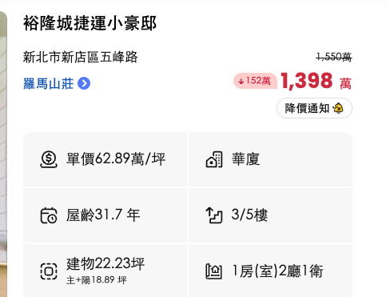
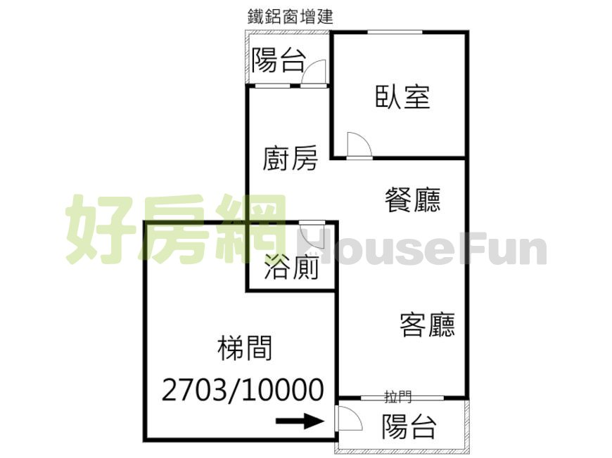
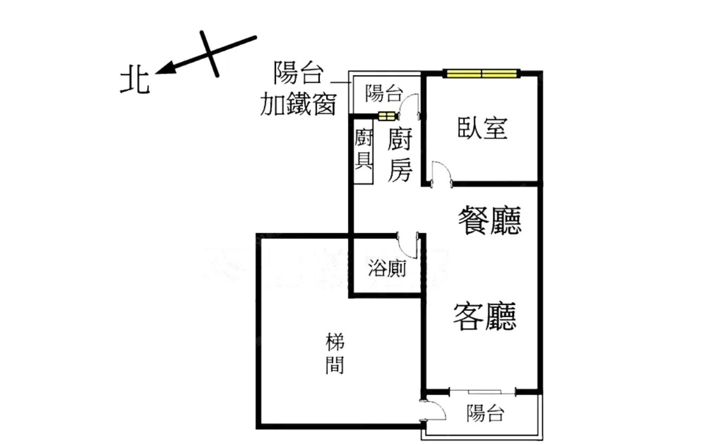

# 新店五峰路・羅馬山莊（裕隆城捷運小豪邸）

> 資料來源：房仲物件頁截圖、好房網平面圖、永慶房仲網照片（2026-10-06 整理）。
> 照片為廣角拍攝，空間看起來會比實際大；實際尺寸以坪數與平面圖為準，再用照片中的門、插座、地板條寬等標準物件校正。

## 物件資訊

| 項目 | 內容 |
| --- | --- |
| 地址 | 新北市新店區五峰路（羅馬山莊社區） |
| 總價 | **1,328 萬**（2026-11-12 降價；原開 1,550 萬 → 1,398 萬 → 1,328 萬，共降 222 萬） |
| 單價 | 59.74 萬／坪 |
| 型態 | 華廈 |
| 樓層 | 3 / 5 樓 |
| 屋齡 | 31.8 年（約 1995 年完工） |
| 建物坪數 | 22.23 坪（主建物＋陽台 18.89 坪） |
| 公設 | 約 3.34 坪，公設比約 15%（由上兩數推算） |
| 格局 | 1 房 2 廳 1 衛 |

## 平面圖

平面圖觀察（尚未實測，僅就圖面與照片判讀）：

- **入口在前陽台**：平面圖箭頭由梯間進入前陽台，照片 03 可看到陽台外側的大門。也就是說沒有室內玄關，進門後經陽台拉門進客廳。
- **長條形一字動線**：前陽台 → 客廳 → 餐廳 → 廚房 → 後陽台，公共空間連成一條，採光主要來自前陽台的落地拉門。
- **臥室在後側角落**，有一般窗加一扇高窗，房門開在餐廳旁。
- **浴廁在中間**，平面圖上沒有對外窗，靠排風扇換氣。
- **廚房開放**，與餐廳之間沒有隔間門。
- **後陽台為鐵鋁窗增建**（圖面標註），屬加蓋部分。
- 梯間標示「2703/10000」，推測是梯間的持分比例，需向房仲確認。

## 座向（依 02-平面圖-含指北.png 推算）

- 前陽台與客廳落地窗朝 **西北偏西（約 290°）**：夏天傍晚西曬直射客廳。
- 臥室窗、後陽台朝 **東南偏東（約 110°）**：有晨光，但窗外緊鄰邊坡，實際採光有限。
- 客廳、餐廳、臥室那道長外牆朝 **南南西（約 200°）**：下午受熱，冬天也較溫暖。
- 梯間在北北東側。

## 照片

| # | 檔案 | 空間 | 看到的重點 |
| --- | --- | --- | --- |
| 01 | [01-客廳-看向前陽台-1](photos/01-客廳-看向前陽台-1.png) | 客廳 | 落地拉門加上方氣窗、分離式冷氣、左牆有一扇高窗 |
| 02 | [02-客廳-看向前陽台-2](photos/02-客廳-看向前陽台-2.png) | 客廳 | 左側深色石紋磚主牆、天花板有梁、陽台外看得到綠意與高樓 |
| 03 | [03-客廳-電視牆與入口](photos/03-客廳-電視牆與入口.png) | 客廳 | 電視牆、弱電箱、陽台外側可見大門（入口在陽台） |
| 04 | [04-餐廳-看向廚房與臥室門](photos/04-餐廳-看向廚房與臥室門.png) | 餐廳 | 廚房開放無門、廚房牆面有外露的給排水管（疑似洗衣機位）、右為臥室門 |
| 05 | [05-廚房-流理台與爐具](photos/05-廚房-流理台與爐具.png) | 廚房 | 一字型流理台、雙口爐、排油煙機、玻璃烤漆壁面 |
| 06 | [06-廚房-看向後陽台](photos/06-廚房-看向後陽台.png) | 廚房 | 爐台旁有窗、冰箱在對面、盡頭為後陽台門 |
| 07 | [07-後陽台-鐵鋁窗增建](photos/07-後陽台-鐵鋁窗增建.png) | 後陽台 | 加蓋採光罩與格柵窗、窗外緊鄰邊坡擋土牆、熱水器在此 |
| 08 | [08-臥室-窗側](photos/08-臥室-窗側.png) | 臥室 | 一般窗加高窗、分離式冷氣、窗外為後側邊坡 |
| 09 | [09-臥室-衣櫃側](photos/09-臥室-衣櫃側.png) | 臥室 | 一整面推拉門衣櫃 |
| 10 | [10-浴廁](photos/10-浴廁.png) | 浴廁 | 有浴缸加淋浴拉門、立柱式面盆、百葉門 |

## 看屋時待確認

- 臥室與部分牆面下緣有斑駁痕跡（照片 08、09），需現場確認是否為壁癌或滲水。
- 後陽台與臥室窗外緊鄰邊坡擋土牆：採光、通風、濕氣與邊坡安全狀況。
- 後陽台增建的合法性與漏水狀況。
- 浴廁無窗的通風效果。
- 梯間持分比例與管理費。

## 價格評估（2026-10-06 修正，推估）

- 開價紀錄（永慶房仲網，經紀人：永慶中興中正直營店 陳建榮）：

| 日期 | 開價 | 單價 | 降幅 |
| --- | ---: | ---: | ---: |
| 原開 | 1,550 萬 | 69.73 萬/坪 | — |
| 2026-10-06 前 | 1,398 萬 | 62.89 萬/坪 | −152 萬 |
| 2026-11-12 | 1,328 萬 | 59.74 萬/坪 | −70 萬（累計 −222 萬，−14%） |

- 2026-11-12 開價 1,328 萬與建議區間的差距：首次出價 850–880 約低 34–36%，目標 900–950 約低 28–32%，上限 1,000 約低 25%。降價不改變估值，出價區間維持不變。
- 依漲幅與成交推估合理價 **約 1,050–1,150 萬（47–52 萬/坪）**。建議首次出價 1,000–1,050 萬，目標 1,080–1,150 萬，上限約 1,180 萬（已考慮水電重拉與浴室改造約 60–100 萬）。
- 推估方法：
  - 社區 2022/07 最高成交 40.3 萬/坪 × 新北信義房價指數 2022Q3→2026Q2 漲幅約 16%（136.71→158.17）≈ 47 萬/坪，小坪數加 5–10% → 49–52 萬/坪。
  - 同社區 2F 48.94 坪含車位，目前開價 2,298 萬（約 47 萬/坪，樂屋網），開價通常高於成交約 1 成 → 約 43 萬/坪；本戶無車位、小坪數加成 → 47–49 萬/坪。
  - 2026/08 新店區公所站附近屋齡 46–53 年公寓成交 46–50 萬/坪（信義）。
  - 新店成屋中位數 2022 45.4 → 2025 47.5 萬/坪（LandChart，+4.6%）；中信統計新店 2025 年漲 4.8%。
- 社區成交：2022/07 40.3、2022/02 33.8、2021/12 29.0、2021/11 31.8 萬/坪（成家網，未註明樓層與車位）。
- 缺 2023 年後的社區成交紀錄，取得後需校正。

### 2026-11-06 重估：新案單價 × 屋齡折舊 × 議價（Tina 的估價法）

- 公式：附近建商新案單價（扣車位，代表地段價值）× 屋齡折舊率 × 議價 0.85–0.90。
- 屋齡 31.7 年 → 折舊率 0.65 −（11.7 × 0.01）≈ **0.533**。
- 地段價值錨點（J大不動產新店預售行情，2026-10 查）：七張站旁「佳元柒章」（寶橋路 29 巷）成交均價約 88 萬/坪（2024），新店平地近捷運新案多在 80–98 萬/坪；山邊新案約 50–75 萬/坪。本社區走到七張有上坡、又是風景區，地段價值取 75–88 萬/坪。
- 結果：

| 地段價值 | × 0.533 | × 議價 0.85–0.90 | 總價（22.23 坪） |
| --- | ---: | ---: | ---: |
| 88 萬/坪 | 46.9 | 39.9–42.2 萬/坪 | 約 886–938 萬 |
| 80 萬/坪 | 42.6 | 36.2–38.4 萬/坪 | 約 806–853 萬 |
| 75 萬/坪 | 40.0 | 34.0–36.0 萬/坪 | 約 755–800 萬 |

- 交叉比對：社區 2022/07 最高成交 40.3 萬/坪（≈ 896 萬），玉山線上估價 935–1,031 萬（2026-10-08），都落在公式上緣附近。之前用房價指數加成推出的 1,050–1,150 萬偏高。
- 風景區：改建價值低、銀行鑑價可能保守。成交價高於銀行鑑價的部分貸不到，要自己拿現金補。
- **建議（取代 10-06 的區間）**：首次出價 **850–880 萬**，目標 **900–950 萬**（約 40.5–42.7 萬/坪），上限約 **1,000 萬**（玉山估價區間內，貸款成數較不會被砍）。

## 設計評估

- [退休宅評估（人生規劃角度）](評估-退休宅.md)
- [購屋與裝修資金準備](預算-購屋與裝修.md)
- [配置平面圖與 3D 示意](design/index.html)（線上版：https://claude.ai/artifact/93gTTxz69S79brFmzyXqpx）

## 追蹤文件（Claude Docs）

- [貸款評估與月繳](https://claude.ai/code/artifact/a2f99cc1-6dfe-4a7f-a1f4-9b2090c0e90e)
- [房子設計](https://claude.ai/code/artifact/fd6fa550-b010-4767-b21d-13828aaa856d)
- [交屋後裝修與家具](https://claude.ai/code/artifact/7394211e-f361-4a3d-8ab9-30ce76fd1206)

## 土地使用分區（2026-11-04 查）

- 信義房屋同社區物件（01057U，羅馬山莊 2/5F 華廈）標示：**風景區；自來水設施用地；人行步道**。https://www.sinyi.com.tw/buy/house/01057U
- 國土測繪圖資服務雲 / api.nlsc.gov.tw 從雲端無法連線，未能直接在圖上確認；同社區不同棟可能落在不同地號，需以本戶謄本地號＋「土地使用分區證明書」確認。
- 影響：風景區建蔽、容積遠低於住宅區（一般約建蔽 20%、容積 60%，以新北市公告為準），日後都更／重建很難蓋回原量體，改建價值低；房貸估價與成數可能較保守，簽約前問銀行。好處是周邊開發強度低、環境安靜。
